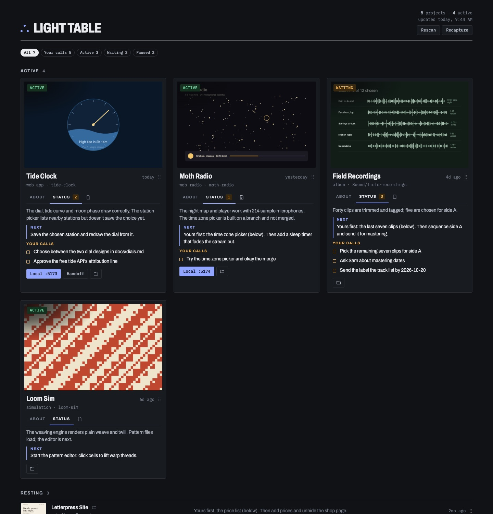

# Light Table

A local board of all your projects, kept current by your coding agent. For Mac, with Claude Code.

**[See the demo board →](https://studiotherefore.github.io/light-table/)** (invented projects, read-only, nothing to install)



One dark page at `http://localhost:8130` answers, at a glance: what's active, where each project stands, what the next step is, which decisions are waiting on you, and what it looks like now.

- **Active** projects get large cards: screenshot, status and three tabs. **About** says what the project is. **Status** shows where it stands, the next step and **your calls** (decisions only you can make). **Notes** holds your own notes, which no agent ever touches. Each card has buttons for the live site, local server, handoff file and folder.
- **Resting** projects are compact rows (click the text to write a note); **Archive** folds away at the bottom.
- **Drag** cards between shelves and into your own order; it saves.
- **Click a project's name** to open its latest Claude Code session (or start one in its folder).
- **Hover** the stacked-frames icon to cycle through recent screenshots.

Your agent keeps it current:

- **Wrap up** any time you want a card refreshed now (say "wrap up", or run `/light-table:light-table-wrap-up` in Claude Code): the agent rewrites the project's entry (now, next step, decisions, status) and screenshots the app.
- **Nightly sweep**: finds projects whose files changed, updates just those from their docs and git log, refreshes screenshots, rebuilds the board.
- **Cloud sessions**: work pushed to GitHub from a cloud session, another account or another machine reaches the board too. The sweep reads it (read-only, through `gh`), and tells you if the branch isn't merged yet. Paste one end-of-session block into those projects' `CLAUDE.md`: see [docs/cloud-wrapup.md](docs/cloud-wrapup.md).

Everything runs on your Mac. Status lives in one file in your own table folder (`~/.light-table/projects.json`); **your project folders are only ever read.**

## What you need

- **A Mac.** Light Table doesn't run on Windows or Linux yet.
- **Claude Code**, in the [Claude desktop app](https://claude.ai/download) (its Code tab) or in Terminal.
- **Python 3.** The first time anything runs `python3`, macOS may offer to install Apple's command line developer tools, a free download of a few minutes. Say yes; that includes Python 3.
- **Google Chrome**, optional, for automatic screenshots of your projects.

## Try the demo on your Mac

The [demo board](https://studiotherefore.github.io/light-table/) is online. To run it on your own Mac, with dragging and notes working, open **Terminal** (in Applications → Utilities) and paste these two lines. The first downloads Light Table into your home folder; the second opens the demo in your browser.

```bash
git clone https://github.com/studiotherefore/light-table && cd light-table
LIGHT_TABLE_HOME=demo/table python3 core/open.py
```

## Install for Claude Code

1. Put your projects in one folder (subfolders are fine), e.g. `~/Projects`. Light Table only reads them.
2. Open Claude Code in any folder: in the desktop app, open the **Code** tab and start a session.
3. Type these two lines, one at a time:

```
/plugin marketplace add studiotherefore/light-table
/plugin install light-table@light-table
```

Then ask: **"Set up Light Table."** The agent asks which folder holds your projects, reads each one's README / CLAUDE.md / handoff notes, drafts an entry for each (anything it guessed is marked "unconfirmed"), lets you correct the list, and opens the board.

Optional: **one row of buttons above the prompt** (Open, App, Local, Live, Board, Hide, plus the decisions list). Its Local button starts a stopped dev server. This uses an early-access Claude Code API that still changes. See [claude/panel/README.md](claude/panel/README.md).

## Codex

**Codex isn't supported yet.** Light Table is being finished for Claude Code first. The `codex/` folder holds early, untested work toward it; don't rely on it.

## Everyday use

| You want to | Say (or press) |
|---|---|
| See the board | "Open my board" (or **⠿** in the panel) |
| Record where a project stands | "Wrap up" (`/light-table:light-table-wrap-up`) |
| Catch up every project now | "Run the Light Table sweep" (`/light-table:light-table-sweep`) |
| Choose a project's cover image | Name an image in its folder `…current….png` |
| Keep headless screenshots off for a project | Set `"autoCapture": false` on its entry |

The nightly sweep: [schedule/README.md](schedule/README.md).

## What's where

```
core/        the board: build.py, server.py, sweep.py, cloud.py, snap.py, open.py, template.html
             config.example.json, projects.example.json, RECORD.md (every field and rule)
skills/      light-table-setup, -wrap-up, -sweep, -open (Agent Skills format)
demo/        an invented board to try it out (the image above)
claude/      the optional Claude Code panel
codex/       early Codex work (not supported yet)
schedule/    nightly sweep through launchd for anyone without the Claude app's scheduler
```

Your table folder (`~/.light-table`, or `$LIGHT_TABLE_HOME`) holds `config.json`, `projects.json`, Wrap up screenshots (`shots/`) and generated files. It's never inside this repo.

## Privacy

- The board server listens on `127.0.0.1` only and refuses requests from other sites.
- Agents following these skills write only to the table folder. They never edit, commit or push in your project folders (git there is read-only: log, status, diff).
- Agents never move your cards: `shelf` and `rank` are yours.
- Backup is off unless you make the table folder a Git repo with your own private remote.
- The record holds your project names, notes, people and deadlines. Don't put your table folder in a public repo.
- Found a security problem? See [SECURITY.md](SECURITY.md).

## If something goes wrong

- **The board doesn't open.** Ask Claude "open my board": it starts the board's small server if needed. If another program already uses port 8130, set a different `"port"` in `~/.light-table/config.json`.
- **No screenshots on the cards.** Automatic screenshots need Google Chrome, and a project needs a live site or a running local server. Or choose a cover yourself: name an image in the project's folder `…current….png`.
- **A card is out of date.** Say "wrap up" in a session in that project's folder, or run the sweep.
- **The nightly sweep stops.** A scheduled run waits silently when it hits an approval prompt. Run it once by hand with **Run now** and choose **Always allow** for each command (see [schedule/README.md](schedule/README.md)).
- **Something else:** [open an issue](https://github.com/studiotherefore/light-table/issues/new/choose). Don't paste your `projects.json` or a screenshot of your own board there: issues are public.

## Uninstall

1. In Claude Code: `/plugin uninstall light-table@light-table` (and `light-table-panel@light-table` if you added the panel).
2. If you set up the nightly sweep, delete its scheduled task in the Claude app (or unload the launchd job, see [schedule/README.md](schedule/README.md)).
3. Your board and notes are in `~/.light-table`. Delete that folder to remove them too. Your project folders were never changed.

Light Table is a personal project, shared as is under the [MIT license](LICENSE). Issues and ideas are welcome (see [CONTRIBUTING.md](CONTRIBUTING.md)); fixes come as time allows.
